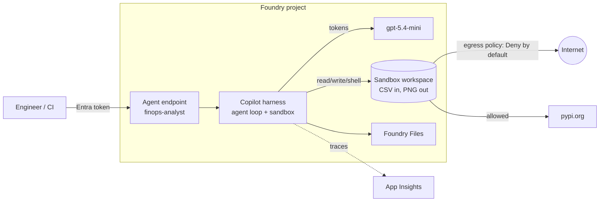

# Governed FinOps analyst on the Microsoft Copilot harness

A prompt agent on the **Microsoft Copilot harness** in Foundry Agent Service (public preview, Oct 2026) that reviews a weekly Azure cost export, flags anomalies, and returns a manager summary, a JSON block and a PNG chart.

The point isn't the agent. It's what an enterprise platform team would ask for before letting an agent with a **shell** near their data:

| Concern | What this repo does |
|---|---|
| Infrastructure as code | One `azd up`. The `microsoft.foundry` provider creates the project and model; hooks cover the rest. |
| Least-privilege tools | Only `filesystem_read`, `filesystem_write` and `shell`. Web and subagents are off. |
| Network egress | RAI policy, **default Deny**, Enforced. Allow-list: PyPI and this project's App Insights. Everything else gets HTTP 403. |
| Identity | Entra only. The agent's own identity gets **Foundry User** after deploy (it doesn't exist before). CI uses OIDC with Foundry User only: it can run evals, not deploy. |
| Observability | App Insights connected to the project: server-side traces, including one span per egress decision. |
| Quality gate | 15 synthetic cost exports with seeded anomalies. CI fails on recall < 0.90, precision < 0.80, week total off by > 1%, no chart, or egress not blocked. |
| Cost | Budget alert on the resource group. Harness runtime is free until 2026-12-01, then USD 0.0994/vCPU-hour + 0.0118/GiB-hour plus model tokens. |

## Architecture



## Run it

Prereqs: `azd` 1.37+, the `microsoft.foundry` azd extension, Azure CLI, Python 3.9+, a subscription in a [supported region](https://learn.microsoft.com/azure/foundry/agents/concepts/limits-quotas-regions#microsoft-copilot-harness-preview).

```bash
azd extension install microsoft.foundry
export AZD_ALPHA_ENABLE_AGENTS_MANAGED_HARNESS=true   # every shell, during the preview
azd auth login
azd env new finops-demo --location canadacentral
azd up

python3 -m venv .venv && . .venv/bin/activate && pip install -r requirements.txt
python chat.py sample-data/cost-export-2026-11-01.csv --prompt "Review this week's cost export."
```

Try the egress policy:

```bash
python chat.py sample-data/cost-export-2026-11-01.csv --prompt \
  'Use shell to run: curl -s -o /dev/null -w "%{http_code}" https://example.com'
# -> 403
```

Run the eval gate:

```bash
python evals/generate_data.py   # optional: regenerate the 15 cases + sample
python evals/run_evals.py       # writes evals/results/latest.md
```

CI setup (one time, needs rights to create an app registration): `./scripts/setup-github-oidc.sh`.

Tear down: `azd down --purge --force`.

## Detection rule

Deterministic on purpose, so the evals have a ground truth. Over 28 days of daily cost per resource, the last 7 days are the analysis week:

- `spike` / `step_change`: first day > 2x the resource's baseline median **and** ≥ USD 25 above it (`step_change` if it stays there).
- `new_resource`: no baseline cost and > USD 100 in the analysis week.

## Results

RESULTS_PLACEHOLDER

## Things I learned (preview, Nov 2026)

LEARNINGS_PLACEHOLDER

## Credits

Started from Microsoft's [`csv-chart-analyst`](https://github.com/microsoft-foundry/foundry-samples/tree/main/samples/cli/prompt-agents/microsoft-copilot-harness/csv-chart-analyst) sample (MIT). Docs: [Copilot harness how-to](https://learn.microsoft.com/azure/foundry/agents/how-to/use-tools-skills-copilot-harness), [announcement](https://devblogs.microsoft.com/foundry/microsoft-copilot-harness-in-foundry/).
